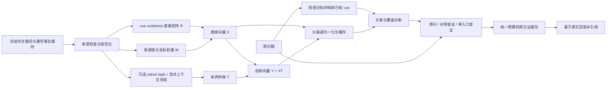

# EICR：证据诱导的 Cue 表示与入口扰动查证

**详细设计与实现规格 v1 · 2026-11-18**

状态：设计冻结候选，尚未实现本规格，未运行本规格下的新实验。文中数值分为数学约束、工程起点和待开发集选择的决策阈值；不把起点当成有效性结论。

配套：[设计参数](design_defaults.json) · [前一版可行性说明](concept_note.md) · [阅读说明](../README.md)。

## 1. 方法主线与研究命题

本方法处理的问题是：用户问题中一个或多个记忆入口存在扰动，系统若把所有入口都作为硬条件检索，可能沿错误线索召回错误经历，或者把真正证据过滤掉。

**主线：将已有语义标签表示为其下游证据上的稀疏向量；在大规模原文召回前，用标签的关联结构识别值得查证的不一致；保留原问题，并把有限原文预算分配给不同证据方向，最后根据原文回答。**

这里“召回前”指重型原文召回/阅读之前。向量已经使用了离线证据关联，因此不能宣传成“完全不访问记忆就发现错误”，也不能说整个在线流程无检索成本。

工作名：**Evidence-Induced Cue Representation，EICR，证据诱导的 Cue 表示**。核心研究假设是：个人记忆中由实际下游证据诱导的标签关联，比只使用标签文字的语义相似度，更能帮助入口扰动下的证据选择。是否成立需要独立对照验证。

### 1.1 本规格固定的对象

| 对象 | 定义 | 不作出的假设 |
|---|---|---|
| cue | 已有的 MRAgent 式语义标签/关键词节点 | 不是新问题临时生成的完整事实、关系约束或事件 |
| evidence unit | 已有重写事实单元，有明确原文出处 | 不保证独立，不保证完整，不必对应一个事件 |
| source | 可以实际阅读和引用的原始记录/原文跨度 | 同源不等于同事件 |
| tag | 原抽取中的短主题分桶 | 不自动具备动作、角色、事件身份 |
| topic | 原系统已有的会话内主题对象 | 与 tag 分属不同命名空间，不跨会话自动合并 |
| cue vector | 由 cue→evidence 关联及可选结构计算的向量 | 不通过 cue 文本 embedding 编码器生成 |
| association | 两个 cue 在此记忆快照中的证据关联 | 不是同事件概率、正确概率或错误概率 |

数学上，图导出的向量仍可以称为 embedding；准确表述是“非文本编码的证据诱导表示”，不能笼统声称“不是任何形式的 embedding”。

### 1.2 第一版作出的决定

1. 必需骨架是 **cue–evidence 二部图**；source 为溯源对象。
2. tag 保留为可选分面，取消必须经过 tag 才能到 evidence 的限制。
3. 直接证据向量是主表示；仅允许一个保留直接通道的、离线一步结构增量。
4. 首个结构增量只用已有 native topic 和明确登记的上下文链接；通用 tag 不默认构成邻接。
5. 不建全局 cue–cue 图，不做在线多跳游走，不先引入事件实体、低秩分解或神经图模型。
6. 不自动改写或删除可疑入口。在线输出“查证对象与证据配额”，最终判断来自原文。
7. 默认仅记录诊断。决策阈值冻结后，才启用自适应路由；参数文件中的空阈值有明确降级行为。

“事件”不再是中间监督对象或必要的离线单位。一个 cue 同时支持购物、做饭和偏好表达，直接表现为多个证据坐标上的非零值；无需先决定它们是否是同一个完整事件。

## 2. 系统边界与总体流程



离线矩阵构建不新增 LLM 调用，复用已有抽取资产；这些资产原本的抽取成本仍应计入系统总账。在线允许一次 cue 前端调用与一次最终回答调用。向量计算、诊断和预算策略本身不用 LLM。前端可使用确定性匹配补充 LLM 输出，但不增加事实推理任务。

第一版只承诺支持“关联异常的查证”，不承诺解决所有入口扰动。两入口矛盾、多个入口共同偏向错误经历、关系语义未进入图等情况，存在结构性不可识别边界。

## 3. 复用 MRAgent 的范围与图结构

本地实现核查依据如下；这是对当前工作区代码的说明，不代替对原论文全部版本的文献核验。

| 位置 | 本地行为 | 适配决定 |
|---|---|---|
| `memory/system.py:16` | KeyNode 保存 key 和 tag→episode 关系 | 保留 cue 身份与原三元关联 |
| `memory/system.py:100` | Link 含 key、event、type、tag | 忠实导出，不能只保存两张无约束表 |
| `agent/agent.py:794` | ID/embedding 对应重写句，展示 text 可为整个原 turn | evidence 坐标采用重写事实，原文单独保存 |
| `agent/agent.py:849` | 原生 key→sentence 直接边，同时维护 key_to_values | 直接构造 R，不强制经过 tag |
| `memory/controller.py:285` | full/partial key 匹配可直接取 content | 可复用原有接口思想 |
| `prompts/prompts.py:24` | 时间缺失时补 conversation date，区间取中点 | 默认不把该字段作为精确发生时间或硬排斥条件 |
| `experiments/entry_sensitivity/adapters.py:25` | 可由冻结 pack 离线恢复 memory | 新 adapter 直接读 pack，避免引入运行中的 Agent 副作用 |

源文件：`system.py`（原工作区引用：`../../Reproductions/MRAgent/memory/system.py`）、`agent.py`（原工作区引用：`../../Reproductions/MRAgent/agent/agent.py`）、`controller.py`（原工作区引用：`../../Reproductions/MRAgent/memory/controller.py`）、`prompts.py`（原工作区引用：`../../Reproductions/MRAgent/prompts/prompts.py`）、`adapters.py`（原工作区引用：`../../Reproductions/MRAgent/experiments/entry_sensitivity/adapters.py`）。

逻辑结构命名为 **带分面的 cue–evidence 二部图** 即可。它不是靠改名获得的新三层图：cue 和已有事实抽取继承 MRAgent；新工作在于下游证据诱导表示、直接/结构分离、诊断与预算控制。论文应明确引用继承关系。

## 4. 数据合同：先保证向量确实代表已有证据

### 4.1 快照与输入

每个索引只属于一个 `owner_id + snapshot_id`。快照清单至少保存：允许的原文 ID、时间/会话前缀边界、输入文件哈希、抽取版本、adapter 版本、参数哈希、构建时间。

必需输入为 `raw_text`、重写 `sentence` 的 `id/text/origin`、关键词的 `sentence_id/keyword`；tag、topic、时间、明确上下文链接是可选输入。按 ID 连接，不假设两个列表的第 n 项天然对应。旧缓存若只有会话序列，adapter 必须检查该序列的会话身份、长度及所有 sentence ID 引用后再接受。

**顺序：先过滤合法 owner 和快照来源，再计算去重、cue/别名、族权重、topic 频率和邻域。** 未来来源派生的节点、别名、边或统计不能遗留在更早快照中。一个重写事实的所有 origin 都必须合法；不得删掉未来 origin 后保留该事实作为已知信息。

若无法证明某批抽取只使用了合法前缀，标记 `snapshot_unverified`，不能进入严格前缀实验。查询侧不能读取答案、扰动标签、修改位置或原始正确问题。

### 4.2 核心表

| 表 | 最小字段与约束 |
|---|---|
| `sources` | owner、source_id、原文、原始顺序/时间、来源根 ID；原文不可被重写句覆盖 |
| `cue_nodes` | cue_id、native_key、canonical_text、explicit_aliases、scope_role、snapshot_id |
| `evidence_units` | evidence_id、native_ids、rewrite_text、origins[]、family_id、tag/topic 引用、time_provenance |
| `cue_evidence` | cue_id、evidence_id、direct_weight、edge_origin、native_record_id；同一对唯一 |
| `cue_facets` | cue_id、facet_kind、facet_id、evidence_id、allocation_weight、origin；保留三元对应 |
| `evidence_neighbors` | from、to、edge_kind、raw_strength、topic/link 来源、候选与裁剪原因 |
| `cue_profiles` | direct/expanded CSR 行引用、范数、证据质量、来源族数、稀疏度、签名、index_hash |
| `build_report` | 缺失/隔离记录、去重、hub、扩展覆盖、时间来源、资源用量、验收状态 |

`edge_origin` 至少区分原关键词边、原系统 speaker/owner 注入边和结构派生边。原生注入边可以保留用于兼容导出，必须显式标记；owner 自身不参与多数诊断。不要把“speaker 出现在来源中”升级为“speaker 参与了句中所有动作”。

### 4.3 ID、精确去重与缺失

- cue 身份沿用原库的 key/ID，在 owner 下命名空间隔离。Unicode NFC、空白处理、大小写不敏感键仅用于查找；不同原生节点不能因为 casefold 相同就静默合并。
- 规范化匹配得到多个原生节点时就是歧义。显式别名必须有出处与快照版本；不能利用当前问题正确答案生成别名。
- evidence 去重要求同一 owner、同一完整原始出处集合、保守规范化后相同重写文本，以及不冲突的已有时间/属性元数据。规范化只处理 Unicode/空白，不删否定、数量、标点或日期。
- 同文但不同日期、不同 source、不同真实发生保留不同坐标。原文显示相同但重写事实不同，也保留不同坐标。
- 合并后的 evidence 保存全部 native ID 别名；关键词先通过 native ID 连接，再投影到去重坐标。同一 cue/evidence 边取 max。
- 没有 keywords：事实仍存在，R 不补猜测边。没有 rewrite：原文仍可供基线召回，表示层记录缺口。非法/悬空 ID 进入隔离报告，不按相似文本猜 join。

默认遇到引用损坏时使该 snapshot 的正式构建失败；可提供 `quarantine` 审计模式查看其余部分，但隔离构建不得混作完整索引结果。

### 4.4 来源族的确定规则

来源族用于限制已知同源派生事实的总权重，**不表示事件，也不保证统计独立**。

第一版采用可复现的保守规则：

1. 一个原始 source 是一个根；仅在显式派生/复制关系已知时合并 source 根，不按文本相似自动合并。
2. 将每个 evidence 与其全部 source 根连接；此二部关系的连通分量定义为来源族。
3. 因此同一 turn 的多个重写事实共享族，多 origin 事实也会连接相关的族。
4. 保存连接原因、每族的 source 数/事实数和最大族占比。多 origin 链可能把大量来源合成大族，这是权重方案的局限，不称为一个大事件。

该规则解决已知来源重叠的一部分重复计数，也可能压低内容丰富的长记录权重。后续必须和等权事实向量比较；不要在结果不佳时悄悄变更来源族定义。

## 5. 数学表示：由下游证据直接得到 cue 向量

### 5.1 符号

| 符号 | 含义 |
|---|---|
| M、N、F | 当前 owner/快照的 cue 数、去重事实数、来源族数 |
| R | M×N 非负直接关联矩阵；v1 为二值 |
| w_e、W | evidence 权重及其对角矩阵 |
| X、x_c | 加权直接向量矩阵及 cue c 的行 |
| P、T | 非负、行和为 1 的证据转移矩阵 |
| Y、y_c | 一步结构向量矩阵及其行 |
| beta、lambda | 扩展幅度、最终结构通道份额 |
| v_c、s(a,b) | 最终单位 cue 向量及其余弦 |

### 5.2 直接关联矩阵

\[
R_{ce}=\begin{cases}
1,&\text{存在原生记录将 cue c 关联到事实 e};\\
0,&\text{否则。}
\end{cases}
\]

重复路径不累加；推断边不写回 R。此边只表示原抽取给出的关联，不自动等价于“事实明确支持完整关系”。

设 e 所在族有 n_{f(e)} 个去重事实，采用候选权重：

\[
w_e=\frac{1}{F n_{f(e)}},\qquad W=\operatorname{diag}(w_e),\qquad
\boxed{X=RW^{1/2}}.
\]

若 N=0，返回 `empty_index`，不做归一化。非空时每族总质量为 1/F，所有坐标质量之和为 1。

向量 x_c 已经完成“通过下游证据计算 cue 的向量化表示”。不需要训练编码器，也不需要预先确定事件数或事件身份。

\[
s_0(a,b)=\frac{x_ax_b^\top}{\|x_a\|_2\|x_b\|_2}
=\frac{\sum_e w_eR_{ae}R_{be}}
{\sqrt{\sum_e w_eR_{ae}^2}\sqrt{\sum_e w_eR_{be}^2}}.
\]

二值情况下，分子是加权共同事实质量，分母调整两个标签的证据规模。开平方使一个坐标在点积中的权重正好为 w_e；若直接用 R W，贡献会变成 w_e²。

### 5.3 “分布”与向量的准确关系

可以为了展示定义一个经验关联分布：

\[
p(e\mid c)=\frac{w_eR_{ce}}{h_c},\qquad h_c=\sum_e w_eR_{ce}.
\]

在 **R 为二值** 时，\(\hat x_c(e)=\sqrt{p(e\mid c)}\)，因此：

\[
s_0(a,b)=\sum_e\sqrt{p(e\mid a)p(e\mid b)}.
\]

这就是两个证据分布的 Bhattacharyya 系数；若采用 \(H^2(p,q)=\tfrac12\sum_e(\sqrt{p_e}-\sqrt{q_e})^2\) 的 Hellinger 约定，则 \(H^2=1-s_0\)。这给“证据空间中的分布”一个精确含义：它衡量两个关联分布的重叠，不是两个 cue 指向同事件的后验概率。

若未来 R 使用非二值强度，上面的平方根分布对应关系应改用与 R² 成比例的质量，不能原样沿用。结构向量 y 也不直接等于 p 的概率传播；本方案传播的是平方根加权特征 x。

### 5.4 不变量与不可忽视的限制

- 零向量输出 `unavailable`，不输出 cosine=0 作为冲突，也不映射到公共 unknown 坐标。
- 一个 cue 整行乘正的 IDF(cue) 不会改变 cosine。泛化标签控制应放在后续参与权重，不能靠这种整行缩放实现。
- 将某一坐标替换为 k 个完全等价副本，各自分得原质量 w_e/k，且不额外截断，直接点积与范数保持不变。
- 上一不变量不覆盖“重新按全族的新事实数量均分”，也不覆盖任意语义拆分或重新建邻域。默认来源族均分没有任意切分不变性。
- 若两个 cue 的 R 行和可用结构完全相同，它们的表示必然相同。丢失的 buy/use、角色、否定或时间归属不能由余弦凭空恢复。

## 6. 可选的一步结构通道

直接向量只对共享事实坐标敏感。不同事实描述同一段经历时可能没有交集；结构通道尝试缓解这一点，但不能把“相关主题”冒充“同事件证明”。

### 6.1 topic 与 tag 的角色分离

- `tag_id = hash(owner, normalized_tag_text)`，只用于可追溯分桶/导航；原三元边保留。
- `topic_id = owner/session_id/native_topic_id`，禁止依据同名自动跨会话合并。
- 默认结构候选来自 `native_topic`；宽泛 tag、相同日期、相同 speaker、相同 session/turn 均不自动构成边。
- `explicit_context_link` 仅接受已有登记关系及其出处；第一版默认没有这种边也可运行。允许的边型名单必须由 adapter 明确声明，不能把任意关系都作为强链接。

### 6.2 确定性候选生成

在合法快照内计算 topic 的唯一事实数 df(t)。保留满足下式的 topic：

\[
2\le df(t)\le d_{\max},\qquad
d_{\max}=\min(64,\max(2,\lfloor0.05N\rfloor)).
\]

这是抑制 hub 的工程起点，尚未验证优劣。超过上限的整个 topic 排除；不能先剪掉成员再把它称为低度 topic。

对每个事实取至多 32 个合格 topic，按 `(df 升序, topic_id 升序)` 选择，称为 F_e；记录忽略项。候选邻居为这些 topic 成员的并集，再加已有显式链接目标，排除自身。topic 倒排生成候选后，计算相似度时使用双方各自保留的 F 集合；因截断造成的不对称候选允许存在并被记录。

默认显式链接关闭。若后续启用，每源事实最多检查 64 个已登记目标，超过则按登记强度降序和 ID 排序截断并报告；不偷偷扩大复杂度。

### 6.3 邻居分数与裁剪

\[
\operatorname{idf}(t)=\log\frac{N+1}{df(t)+1}+1,
\]

\[
J_{\rm topic}(e,f)=
\frac{\sum_{t\in F_e\cap F_f}\operatorname{idf}(t)}
{\sum_{t\in F_e\cup F_f}\operatorname{idf}(t)}.
\]

分母为零时为 0。令 E_{ef}∈{0,1} 表示一个被允许的显式上下文链接，构造：

\[
g_{ef}=\max\{E_{ef},\;0.25J_{\rm topic}(e,f)\}.
\]

保留 g≥0.05 的 top-8 非自身邻居，按 `(g 降序, target_id 升序)` 排序。重复路径取 max，不按 topic 数/路径数累加证据强度。保存边型、贡献 topic、原始 link 和剪枝统计。

### 6.4 弱边衰减不能被归一化抵消

若直接把所有 topic 边乘 0.25 再进行普通行归一化，0.25 会抵消，无法真正降低扩散强度。本规格把衰减保留为自环质量。

对保留邻居定义：

\[
Q_{ef}=\frac{g_{ef}}{\sum_{u\ne e}g_{eu}},\qquad
r_e=\max_{f\ne e}g_{ef},
\]

\[
P_{ef}=r_eQ_{ef}\ (f\ne e),\qquad P_{ee}=1-r_e.
\]

无邻居时 P_{ee}=1。r_e 是工程衰减系数，不是校准后的链接可靠概率。P 非负且每行之和为 1。

\[
\boxed{T=(1-\beta)I+\beta P},\qquad 0\le\beta<1,
\qquad\boxed{Y=XT}.
\]

候选 beta=0.25。只有弱 topic 边时，每行外传质量不超过 0.25 beta=0.0625；这是特征转移质量上界，不是“错误率最多 6.25%”。第一次只传播一步，不对 Y 再传播，不按查询临时改邻域。

### 6.5 两通道分别归一化，再拼接

对于非零 x_c：

\[
\hat x_c=x_c/\|x_c\|_2,\qquad \hat y_c=y_c/\|y_c\|_2,
\]

\[
\boxed{v_c=[\sqrt{1-\lambda}\,\hat x_c,\;\sqrt\lambda\,\hat y_c]},
\qquad 0\le\lambda<1.
\]

beta<1 保证非零 x 对应非零 y。最终向量单位范数，其 cosine 精确等于：

\[
\boxed{s(a,b)=(1-\lambda)s_0(a,b)+\lambda s_1(a,b)},
\qquad s_1(a,b)=\cos(y_a,y_b).
\]

默认主配置 lambda=0；结构对照仅启用一个候选 lambda=0.2，固定 beta，不同时搜索多种复杂扩散器。lambda 对同一 index 全局固定，不能按 cue 对临时改变后仍称统一余弦空间。

由于所有向量非负，s∈[0,1]；若 s_0=0，则 s≤lambda。它保证间接通道的数值份额受控，不保证语义正确。

未归一化结构内积的核为 TTᵀ，半正定；最终 Gram 是两个 cosine Gram 的非负加权和，也半正定。分通道分母不同，不能把最终结果随意改写为同一个未归一化的 x_a K x_bᵀ。

如果所有行都没有结构邻居，P=T=I，Y=X，最终相似度退化为直接 cosine，必须输出 `structure_active=false`。个别无邻居行保留自环，不单独改变 lambda。

即使输入只做一步扩展，两个 y 向量也可能因共享扩展目标而相似；这不是新增独立证据。未归一化可展开为 XTTᵀXᵀ，不能宣称所有非零相似只来自原图的一条直接边。

### 6.6 稀疏存储与近似

X 不截断；Y 第一版也精确存储。不构造完整 M×M 相似矩阵。逻辑向量维度是 2N，实现可分别存储 X、Y、行范数和 lambda，按需取行计算。

若后续因规模必须裁剪 Y，应保留独立配置，记录每行丢失的 L2 能量：

\[
\delta_c=\frac{\|y_c-y'_c\|_2^2}{\|y_c\|_2^2}.
\]

对纯坐标删除且 y' 非零，有：

\[
\|\hat y_c-\hat y'_c\|_2=\sqrt{2-2\sqrt{1-\delta_c}}.
\]

两 cue 的 cosine 误差不超过两边单位向量误差之和，最终结构通道误差再乘 lambda。此保证不能直接用于“先截断 X 再扩展”。不能复用旧概率 profile 的 top-64/L1 尾质量，声称本方法无损。

## 7. tag 分面如何保存，以及为何不做必需中间层

保留精确的 cue–tag–evidence 三元关联。单 tag 时：

\[
A_{c,t,e}=R_{ce}\mathbf1[t(e)=t].
\]

多 tag 时，为每条真实的 cue/evidence 关联保存分配权重 a_{cte}≥0，且对 t 求和为 1；第一版没有原始权重时均分。无 tag 放入 `unclassified`。topic 是另一种分面，不与 tag 混在同一质量分配中。

用于分面观察的特征为 \(x_{c,t,e}=R_{ce}\sqrt{w_ea_{cte}}\)，这使分面平方能量合计回到直接向量平方能量。不能将该分面再次作为新 cue 加入多数诊断。

分面用于回答“这个 cue 的证据主要分布在哪些已有主题桶中”，也可报告质量和熵；不称为事件分布。主向量仍保留所有事实坐标，不先选最有利分面再归一化。

**禁止**将全局 cue→tag 矩阵乘以 tag→content 矩阵，作为原生 R。这样会把同属 Cooking 的所有事实错误地接到每一个 Cooking cue 下。由共享分面产生的链接只能进入独立的结构候选，并清楚标 `derived`。

没有 tag 时，直接表示、诊断和查证仍完整可运行。因此不需要为维持三层图外形而新建一层；新增动作/角色抽取是另一项增强，不应假装已由改名完成。

## 8. 在线前端：只映射已有 cue，不解析完整事件

### 8.1 前端输出合同

```json
{
  "question_id": "q-example",
  "snapshot_id": "owner-prefix-hash",
  "original_question": "原始问题，保留不改写",
  "answer_need": "要查找的答案类别或短描述，可为空",
  "query_shape": "single_lookup | explicit_multi_target | unknown",
  "mentions": [
    {
      "span_start": 0,
      "span_end": 7,
      "surface_text": "问题里的原始片段",
      "candidate_cue_ids": ["existing-cue-id"],
      "match_method": "exact | explicit_alias | lexical_fuzzy | none",
      "status": "unique | ambiguous | unmapped",
      "role": "entry | scope | answer_request"
    }
  ],
  "unresolved_spans": [],
  "parse_truncated": false
}
```

前端只识别与记忆入口有关的原文词/短语和答案需求，不生成完整事实约束，不要求先判断购买/烹饪是否属于同一事件。offset 使用原始字符串的 Unicode 码点半开区间，adapter 不同语言实现时必须显式转换。

可用一次 LLM 抽取短语，确定性程序负责已有 cue 查找、offset 校验和状态分类。格式重试最多一次，单独记账；重试失败走原问路径。模型不得输出未存在的 cue ID 作为已知节点。

### 8.2 映射规则

1. 原生文本规范化唯一相等，或有来源的显式别名唯一匹配：可参加诊断。
2. 存在多个匹配、或只能模糊匹配：保留至多 top-3 现有候选，仅用于辅助召回/诊断展示；v1 不作为可靠投票。
3. lexical fuzzy 可用词元 Jaccard 排序；仅保留正分，稳定按 ID 打破召回排序平局。其分数不是匹配概率，不因此升级成 unique。
4. 未映射片段保留原文与原因，不创建持久 cue，不解释成用户说错。
5. answer_request 和 scope 不作待查证对象。第一人称 owner 只确定记忆范围；其他真实人物 cue 不因类型是人名就一律排除。
6. 多个片段映射同一 canonical cue，只计一次。最多处理 24 个 entry mentions；超限或解析截断时保留原问召回，不能静默删掉部分入口后声称完成诊断。

`mapped_entry_mentions / extracted_entry_mentions` 只衡量抽取结果中的映射比例，不等于完整问题的语义覆盖。前端漏掉某关系、否定或时间归属时，这个比例也可能是 100%。必须在审计样本中另标“问题有区分性语义，但 cue 图未表示”。

如后续使用多候选匹配权重，\(\sum_{kl}\alpha_k\beta_l s(c_k,d_l)\) 与 \(\cos(\sum_k\alpha_kv_{c_k},\sum_l\beta_lv_{d_l})\) 一般不相等。重新归一化均值可能掩盖歧义。v1 不通过这种混合制造一个看似确定的新 cue。

## 9. 关联诊断与查证候选

### 9.1 随相似度保存的量

对每个有效 cue 保存 h_c、事实数、来源族数、scope 状态、分面分布、X/Y 范数和扩展率。每对 cue 保存 s_0、s_1、s 和方向性直接覆盖：

\[
\operatorname{cover}(a\to b)=
\frac{\sum_e w_e\min(R_{ae},R_{be})}{\sum_e w_eR_{ae}}.
\]

coverage 是关联覆盖，不是蕴含。零分母为 unavailable。

全体或候选核心的直接共同支持记录为：

\[
I(S)=\sum_e w_e\min_{c\in S}R_{ce},\qquad
J(S)=\frac{I(S)}{\min_{c\in S}h_c}.
\]

J 仅对非空、且每个成员 h_c>0 的集合定义，否则返回 unavailable。J=0 只表示没有共同的直接事实坐标；J>0 也不证明同事件。各 cue 对分别共享不同事实时，pairwise 可以较高而 J=0，标记 `NO_JOINT_WITNESS`。它限制解释，不作为“必定错误”或“必定不同事件”的判定。结构重合另列，不混入 I。

### 9.2 宽标签与重复票

使用委员会参与权重：

\[
\omega_c=1-h_c/\sum_e w_e=1-h_c.
\]

此式只用于当前二值 R 与归一化 W；scope/owner 的 omega 显式置 0。它降低广覆盖标签的聚合影响，不改变向量几何，也不是正确概率。omega 为 0 或向量不可用时不参加。omega 降低的是该 cue 对其他组共识的影响，并不直接降低它自身被选为查证对象的资格；近似宽标签仍可能有较高 Delta，包含保护也不能解决所有近似包含情形。

同一个 cue 的多次提及先去重。再把**在当前快照中 R 行完全相同的非零 cue**合并成一个临时诊断组，取一份向量与 max omega，保留全部原 cue ID。该分组仅消除完全相同的结构观察，不新建语义节点，不声称成员同义。近似相同不自动合并，但报告高重复关联。

因此 m 表示有效诊断组数，不是原问题中的词数。多个分面、别名或等同下游行不能凑成“多数”。不同组仍可能同源相关；“委员会”是聚合比喻，不是独立投票假设。

### 9.3 单点查证分数

对 m≥3，使用分组后的向量与权重计算：

\[
\kappa_{-i}=
\frac{\sum_{j<k;\,j,k\ne i}\omega_j\omega_k s_{jk}}
{\sum_{j<k;\,j,k\ne i}\omega_j\omega_k},
\]

\[
\ell_i=\frac{\sum_{j\ne i}\omega_j s_{ij}}{\sum_{j\ne i}\omega_j},
\qquad\boxed{\Delta_i=\kappa_{-i}-\ell_i}.
\]

Delta 大表示“其余观察彼此较关联，而这个观察与其余较弱”。它可能对应错误入口，也可能对应正确的补充条件、多事件结构、宽标签或缺失图边。因此字段命名为 `check_priority`，不能用 `wrong_probability`。

各分母必须非零；数值实现采用 float64 和容差，但不以容差替代语义阈值。m=2 没有“其余内部一致性”，不得使用这个公式判定哪边错误。

### 9.4 路由启用条件与降级

默认 `adaptive_routing_enabled=false`，仍计算可用诊断。后续启用时必须指定匹配 index/config 的冻结 policy，至少含 tau_delta、tau_core、tau_margin 和两组对称查证的 tau_pair；这些阈值目前为 null，未选择。

单入口候选 i* 必须同时满足：

1. m≥3，Delta 有唯一最高值，且 Delta≥tau_delta、kappa≥tau_core、第一/第二名差距≥tau_margin。完全平局不得靠 ID 指定谁更可疑。
2. 所有被抽取为 entry 的片段均唯一映射且有非零表示；没有截断、前端错误或显式多目标问题。该保守规则可能降低适用覆盖，应单独报告。
3. 候选诊断组只有一个原 cue。多个不同标签的下游完全一致时，不能用当前表示定位其中哪个词错了。
4. 若候选与任一其他有效组满足任一方向的精确包含（coverage 在数值容差内为 1），标 `CONTAINMENT_AMBIGUITY`，v1 不作单入口特选。
5. 其余至少有两个有效观察；输出 J、来源族重叠和分面诊断，不因 Delta 高就称它们为“已验证的正确核心”。

映射不足或上述条件失败走 ORIGINAL。m=2 且映射完整、s<tau_pair、无精确包含时走 SYMMETRIC_CHECK；它是两边查证，不指定谁错。m<2 走 ORIGINAL。明确的比较/多目标问题走 ORIGINAL，不把合法的多经历差异当成入口异常。

`NO_JOINT_WITNESS` 不强制阻止取证，因为相关事实本来就可能分散；但必须阻止下游报告将“其余核心”说成已证明的同事件。所有路由都仍是探索配额，没有自动修正语义。

关键边界：无法从未被抽取的文本推断“没有漏掉关键入口”。上述 gate 是可观测的保守合同，不是前端完备性保证。

## 10. 有界证据召回与预算分配

### 10.1 输出合同

```text
RouteDecision
  question_id, snapshot_id, index_hash, policy_hash
  mode: ORIGINAL | SYMMETRIC_CHECK | SINGLE_CUE_CHECK
  selected_cue_id: existing ID or null
  observed_mapping_coverage
  diagnostics_ref, reason_codes[]
  queues[{kind, cue_ids, candidate_origins, ranking_version, quota_tokens}]
  evidence_budget_tokens, prompt_token_accounting
```

任何队列名称都不叫 `correct_cues` 或 `wrong_fact`。最终证据包不告诉回答模型“入口已经错误”。

### 10.2 队列定义与排序

| 队列 | 候选生成 | 排序与限制 |
|---|---|---|
| ORIGINAL | 完整原问题，共同 dense+BM25 原文索引 | 固定 RRF，k=60；索引/分块/模型与对照一致 |
| ANSWER_NEED | answer_need 的 BM25 原文检索；为空则空队列 | 不擅自补一个日期或商品；无额外 LLM/默认不增加 embedding 调用 |
| CORE | 除待查证组外，其余组直接 evidence 的并集 | 先按支持组数，再按加权支持，再按 answer_need 词面分数、ID |
| INDEPENDENT_CUE | 待查证 cue 自己的直接 evidence/origin | 仅按该 cue 文本/显式别名做词面排序；按来源族轮转取候选 |

核心的加权支持可以固定为 \(u_e=\sum_{j\ne i}\omega_jR_{je}/\sum_{j\ne i}\omega_j\)。每条候选保留支持它的组与原 cue 列表；支持多个同源事实不能冒充多个独立来源。

v1 CORE 和 INDEPENDENT_CUE 都从直接 R 取候选，不沿结构通道继续扩展。Y 先只影响诊断，便于分离“表示变化”和“更多候选”的收益。结构邻居召回作为后续单独开关。

独立队列不得附加其他入口的日期/地点作为硬过滤，不得要求候选必须与核心高相似；否则系统会先删反证再证明自己正确。v1 也不使用 answer_need 排序该队列：各来源族内按 cue 词面分数降序、跨度 ID 排序；族之间按最高块分数降序、family_id 排序，每族取一块后进入下一轮，直至候选上限。有限预算仍可能遗漏反证，这个规则提供方向独立的取证机会，不保证保留所有不同情境。

每队列保留最多 256 个原文候选跨度，是工程资源上限；裁剪原因和原始候选量写入日志。共享一个 source 的多个事实先合并来源引用，不把原文重复展示当成多条独立证据。

### 10.3 配额起点

| 模式 | 总原文预算 | 保留的队列配额 |
|---|---:|---|
| ORIGINAL | 6000 tokens | 原问 6000 |
| SYMMETRIC_CHECK | 6000 tokens | 原问 4000；两组各 1000 |
| SINGLE_CUE_CHECK | 6000 tokens | 原问 3000；答需 1000；核心 1000；独立 cue 1000 |

这些是待验证的固定起点。正常问题的原问份额减少仍可能损伤答案质量；保底不等于无损保证。

### 10.4 统一装包器

1. 所有方法使用同一冻结原文分块：优先句界、每块至多 384 tokenizer tokens，目标重叠 32；过长单句按 token 切分并标记。真实语料分块版本和 tokenizer 必填，不按方法重切。
2. 有原文跨度映射时取命中块；只有 origin 时取该 origin 的已有块，用该队列的词面/排名规则排序。不能声称 rewrite 自动带有准确 span。
3. 候选保持独立块，不提前对所有重叠候选做传递合并。只对实际选中的同一 source 跨度做增量区间并集，重叠文本只计一次，保留全部队列归因。否则滑窗重叠可能把整篇原文连成超预算长块并被整体跳过。
4. 第一轮依次保留 ORIGINAL、INDEPENDENT（或两侧）、CORE、ANSWER_NEED 的配额；已覆盖的相同文本跨度复用，不消耗新的文本额度，同 source 尚未覆盖的跨度仍需收费。新增片段连同必要标签按其实际渲染增量计费。两侧对称配额轮转装包，起始侧由 question_id 固定哈希决定，与分数/正误无关。
5. 一个跨度无法放入其剩余额度时跳过并记录；不为凑满而静默截断关键句。第一轮未用额度进入共享剩余池，优先补 ORIGINAL，其次独立队列、CORE、ANSWER_NEED；对称两侧仍轮转。
6. 用最终回答模型的 tokenizer 对实际渲染的来源文本及来源标签计数，合计≤6000；问题/系统提示/输出预算另记。若全包重编码略超上限，按确定的最低装包优先级回退并记录，不超预算交付。
7. 保存来源是否因重复、排名上限、token 上限、缺失原文而未入包。记录每队列实际可见 tokens、共享 tokens 与剩余量，不能只报告候选 token 预算。

返回原文支持集合及所有来源引用，不仅返回重写事实。格式化、切块、去重收益要在所有对照中共享。

### 10.5 回答合同

回答模型接收原问题和原文证据，使用统一提示：区分问题中的假设与记忆事实；依据引用回答；若来源支持不同经历或缺少关键关系，说明差异或不足，不强行补全。不得把 Delta/cosine 的数值描述为事实判错证据。

建议记录 `answer_text`、`citations`、`unsupported_premises`、`resolution_status`。对旧评价器可另外投影纯答案文本，但不抹去过程记录。

第一版不自动提出替代 cue。后续若从核心证据的反向索引推荐替代项，必须保持现有节点、保留原入口，并通过独立原文核验，作为另外的实验变量。

## 11. 沙拉例子的完整解释

设已有四个事实坐标，下表只展示抽象关联，**不是实际数据或运行结果**：

| 事实 | 内容示意 | 连接的部分已有 cue |
|---|---|---|
| e1 | 9 月 15 日做 halloumi 沙拉，用了一撮烟熏红椒粉 | 日期、halloumi、pinch、smoked paprika |
| e2 | 另一时间购买烟熏红椒粉和地中海混合香料 | shopping、smoked paprika、Mediterranean blend |
| e3 | 同次购物还买了零食 | shopping、snack |
| e4 | 另一天做另一道菜，加入地中海混合香料 | Mediterranean blend、另一菜名 |

等权简化时，烟熏红椒粉 cue 的直接行是 [1,1,0,0]，halloumi 是 [1,0,0,0]，shopping 是 [0,1,1,0]。前两者 cosine=1/√2，红椒粉与 shopping 为 1/2，halloumi 与 shopping 为 0。

这很好地保留了“同一个商品出现在做菜和采购两个区域”。但绝不能据此宣布购买与做菜无关，更不能由购物边推出“买到的每一样东西都用于沙拉”。

在这个玩具图中，日期、halloumi、pinch 若都只连接 e1，其向量完全相同，诊断时只算一份结构观察，避免三个词制造虚假的三票多数。真实数据中这些 cue 各有不同证据分布，是否形成多个有效观察要由实际 R 决定。

若“2024 年 9 月 15 日”映射到另一组日期证据，它可能成为值得查证的入口；是否最终判为记错日期，必须阅读来源。如果现有图根本没有 buy/use 关联，或者 e1/e2 被合成同一粗坐标，EICR 无法仅凭向量恢复区别。这时优先修复事实单元/边的语义分辨率，而不是增加多跳。

## 12. 必须覆盖的反例与预期行为

| 情形 | 为什么会误导 | 本规格的响应 / 剩余限制 |
|---|---|---|
| 具体 cue 完全包含于广 cue | 等权时 cosine=√(小集/大集)，可以很低 | 输出双向 coverage；参与降权；精确包含阻止单入口特选 |
| 一个 cue 横跨购物和烹饪 | 与两侧都相关，不能传递同事件 | 不建 cue–cue 闭包，保留证据坐标/分面 |
| 三对分别共享不同事实 | pairwise 高不保证全体共同证据 | 保存 J 和 NO_JOINT_WITNESS，不称高阶共识概率 |
| 多词或别名连接完全相同证据 | 同一观察被重复算票 | 同 cue 去重、完全相同行分组；近似相关仍需报告 |
| 全部错误 cue 指向另一个自洽经历 | 结构内部可以非常一致 | 仅凭关联无法发现；评估中必须保留此负例 |
| 一个正确但稀有的补充入口 | 下游缺边也会表现为孤立 | 保留独立队列、原问题，最终读原文；不自动删除 |
| 两个入口彼此不关联 | 图没有第三方依据选择谁错 | 对称查证或原问路径 |
| 一个问题合法地涉及多次经历 | “不一致”可能是题意 | 明确多目标走原问；漏检仍可能发生 |
| buy/use、主客体、否定、计划/完成混淆 | 相同实体标签无法表达关系差别 | 表示不可识别；标语义缺口，引用原文，不伪造关系能力 |
| 同一原 turn 含多个事实 | 相同原文显示导致重复与事件混合 | 重写事实作坐标、原文作来源、来源族控权 |
| 同一事实分散在多个来源 | 直接交集可能为零 | 一步结构仅作可选补充；低分不等于矛盾 |
| topic/tag 过宽或错误 | 平滑会混淆不同经历 | hub 排除、弱边自环、直接通道保留、lambda 上界 |
| RᵀR 等共现再传播 | 同一信息循环强化 | 若研究则单独标为平滑对照，不算新增见证 |
| 缺失事件时间被填为会话日期 | 形成虚假时间冲突 | time_provenance 标记；默认不用作硬边或硬过滤 |
| 多 origin 产生巨大来源族 | 权重可能被过度压缩 | 报告分量分布，与等权基线比较；不能解释成大事件 |
| 前端只识别实体，漏掉关系 | 表面映射率高但问题没被充分表达 | 独立语义覆盖审计，原问保留，不把映射率当完备率 |
| 不同用户/快照的坐标不同 | 向量维度同长也无共同含义 | 不跨库直接算 cosine，缓存必须校验 index_hash |

## 13. 实现模块、接口与产物

以下是**拟建目录和接口**，不是已经存在或可执行的功能。新包与旧 ECP 隔离，避免把旧事件概率实现改名当新实现。

```text
main_lab/eicr_v1/
  src/eicr/
    contracts.py          # typed records / hashes / status enums
    import_mragent.py     # frozen cache → normalized records
    provenance.py         # exact dedup / source families
    incidence.py          # R / weights / profile metadata
    facets.py             # faithful triples / facet diagnostics
    neighbors.py          # eligible topic / g / P / T
    vectors.py            # X / Y / norms / sparse cosine
    query_map.py          # mentions → existing cue candidates
    diagnostics.py        # coverage / joint / duplicate groups / Delta
    policy.py             # frozen thresholds → route mode
    retrieval.py          # bounded common candidate queues
    packer.py             # shared actual-source token budget
    answer.py             # shared source-grounded answer contract
    audit.py              # invariants / trace validation
    cli.py
  tests/fixtures/         # mathematical and data-contract counterexamples
  configs/
  artifacts/<snapshot>/<index_hash>/
```

| 接口 | 输入 → 输出 |
|---|---|
| `import_snapshot(pack, manifest)` | 冻结资产 → 标准表、导入报告；不调用 LLM |
| `build_index(records, config)` | 标准表 → R/W、P/T、X/Y、范数、manifest |
| `map_query(question, registry, frontend)` | 原问 → QueryCueMap；只使用合法 cue 注册表 |
| `diagnose(index, query_map)` | 命中行 → 分组、小矩阵、coverage/J/Delta、状态 |
| `choose_route(diagnostics, policy)` | 诊断与已冻结阈值 → RouteDecision；无阈值则 ORIGINAL |
| `collect_candidates(route, shared_retriever)` | 队列合同 → 带来源的候选列表 |
| `pack_sources(candidates, tokenizer, quotas)` | 原文候选 → 统一来源包及预算账 |
| `answer(question, evidence_pack, backend)` | 原问＋原文 → 回答、引用、状态 |

拟议 CLI 分为 `import`、`build`、`audit-index`、`diagnose`、`freeze-policy`、`run`、`evaluate`。实现前不提供伪装成可执行命令的运行说明。

### 13.1 建议的索引产物

```text
manifest.json                  # owner / snapshot / input+config hash
sources.jsonl                   # 原文或对冻结原文的可校验引用
source_roots.jsonl              # 原始根与明确派生关系
source_family_membership.jsonl  # source/evidence → family；含连接理由
cue_nodes.jsonl
evidence_units.jsonl
cue_evidence.jsonl
cue_facets.jsonl
evidence_neighbors.jsonl
weights.npy
R.npz, X.npz, Y.npz             # scipy CSR；direct-only 可省略 Y
P.npz, T.npz                   # 可选结构配置；direct-only 可用 manifest 标 I
norms.npz
cue_profile_metadata.jsonl
build_report.json
```

邻居表需保存最终保留状态、g、Q、r 及裁剪版本，保证 P/T 可由冻结数据确定性重建；文件落盘后校验重建一致。来源根与族成员表不能只以最终 w 替代，否则无法解释哪些来源合并影响了权重。

在线每题保存 query_map、diagnostics、route、candidate_trace、evidence_pack、token_ledger、answer、error_status，且都引用同一 index_hash。不保存凭证或完整供应商错误响应。

### 13.2 与旧基础设施的关系

可审查后复用旧目录中的快照、来源溯源、预算记账、provider、统一回答与评价基础设施，例如 `snapshots.py`（原工作区引用：`../evidence_committee_v1/src/ecp/snapshots.py`）、`evidence_budget.py`（原工作区引用：`../evidence_committee_v1/src/ecp/evidence_budget.py`）、`provider.py`（原工作区引用：`../evidence_committee_v1/src/ecp/provider.py`）。复用前核对字段与语义，不能因为名字相似就直接兼容。

不将旧 `profiles/consensus/event_graph/event_committee` 作为新方法必需依赖；旧概率 profile、完整事件分组和贝叶斯证据委员会属于不同方法假设。旧结果只作历史记录或明确的对照。

## 14. 复杂度、缓存与成本

设 L=nnz(R)，每事实最终非自身邻居≤k=8，每事实候选 topic 数≤q=32，合格 topic 大小≤d=64。

- 直接导入、R/X 构建和元数据计算主要随输入记录和 L 增长；稀疏存储 O(L+M+N)。来源连通分量可用并查集。
- topic 候选枚举上界约 O(Nqd)；若逐候选扫描最多 q 个 topic，朴素 weighted Jaccard 总成本约 O(Nq²d)。不生成所有 N² 对，不能只限制最终 top-k 就忽略前面候选爆炸。
- T 每行至多 k+1 个非零，Y 稀疏乘法工作量约 O(L(k+1))；输出 nnz(Y)≤min(MN,L(k+1))，实际扩展率必须报告。
- 在线只对最多 24 个已映射 entry 形成小矩阵。两行稀疏点积取交集即可；朴素计算可按行非零长度估计，不做全库 cue 两两扫描。
- 来源 packer、前端与回答的耗时独立记账。只读取缓存向量不意味着整个问答流程零成本。

第一版采用不可变快照完整重建，避免先实现容易失效的增量维护。新增来源可能改变族大小、topic 过滤、归一化和向量；不允许向旧 X 直接追加坐标后继续使用旧范数。将来增量版本必须证明与完整重建一致。

缓存 key 至少包括输入快照哈希、owner、adapter/dedup/family 版本、向量与邻域参数、别名版本。变更 lambda 必须产生新的表示配置身份；X/Y 可按依赖哈希复用，但不能混读旧 route policy。

参数文件故意不填 tokenizer、answer model、数据路径和决策阈值。实现应把这些视为运行所需环境/已冻结实验清单，缺失时报明确状态，不能在代码里隐式选一个模型。

## 15. 参数分层与决策阈值的产生

| 类别 | 内容 | 身份 |
|---|---|---|
| 数学约束 | beta、lambda∈[0,1)，非负、行和、唯一 ID、二值 R | 必须满足，不是可调性能指标 |
| 数值容差 | float64；不变量检查绝对容差 1e-10、相对 1e-8 | 数值实现检查；不是语义概率门槛 |
| 工程上限 | k=8、topic≤32、topic 度≤64/5%、mentions≤24、队列≤256 | 候选起点，影响覆盖与成本，必须记录 |
| 表示候选 | 来源族均分；beta=.25；lambda=0 或 .2；topic 衰减 .25 | 待验证设计，不称最优 |
| 策略候选 | 总预算6000、四队列配额、包含关系保护 | 未验证的控制策略 |
| 决策阈值 | tau_delta、tau_core、tau_margin、tau_pair | 必须从分组开发数据选择后冻结，目前 null |

后续阈值选择必须先声明有限候选网格与选择目标。建议先只评估连续 Delta 的候选排序/适用覆盖，再在开发集选择满足正常题退化上限的策略；退化上限与网格写入实验清单，不根据确认集结果回调。若没有策略满足条件，保持 ORIGINAL，报告未找到可用路由阈值。

同一原问题及所有扰动版本置于同一 split；按 memory/persona 分组，避免同一记忆的来源结构同时进入调参和确认。确认集封存，所有前端/权重/阈值变更都产生新版本。没有来源审定错误标签时，只报告预算/召回/答案效果，不能声称校准了“错误概率”。

## 16. 后续实现顺序与验收门槛

本节是后续工作顺序；本次只交付设计，不执行这些实验。

| 阶段 | 交付物 | 进入下一阶段的条件 |
|---|---|---|
| A：数据适配 | 标准表、来源清单、去重/族报告 | ID join、来源权限/前缀、原三元边恢复通过 |
| B：直接表示 | R/W/X、直接 cosine、coverage、分组与反例 fixture | 数学不变量和稀疏/稠密 oracle 一致 |
| C：诊断管线 | QueryCueMap、小矩阵、Delta、失败/覆盖报告 | 不用 gold；unknown 不被误判；重复票和两 cue 对称性通过 |
| D：统一取证 | 队列与同预算 packer、固定策略对照 | 实际 token 守恒，独立队列未被核心条件过滤 |
| E：结构增量 | native-topic P/T/Y、扩展来源解释 | 真实有扩展；弱边衰减和直接通道边界通过 |
| F：冻结策略与验证 | policy manifest、同底座对照、确认报告 | 先开发选择再冻结，不使用确认集反复调参 |

### 16.1 必须有的性质检查

1. 非空索引权重有限且正，族质量和与全局质量和正确；重复同边不增权。
2. 空索引/零 cue 返回 unavailable；不用公共 unknown 产生相似。
3. P/T 非负、行和 1、无邻居为自环；beta<1 时非零 x 对应非零 y。
4. 拼接范数为1，拼接 cosine 等于分通道加权和；对称、值域、对角线正确。
5. s_0=0 时 s≤lambda；P=I 时两通道结果相同。
6. 仅弱 topic 边时外传质量≤0.25 beta；不能被行归一化抹掉。
7. 稀疏运算与小型稠密 oracle 一致；节点置换只改变索引次序。
8. 明确质量守恒条件下坐标复制不变；任意重切分不作此要求。
9. 原 cue–tag–fact 三元关联可恢复，禁止共享 tag 制造直接边。
10. 更早快照不受未来原文、别名、topic 频率或派生边影响。
11. 同 cue/等同 R 行不重复投票；单/双入口不伪造单点判错依据。
12. 未配置策略必走 ORIGINAL；诊断异常不修改原问题或图。
13. 独立队列保留与核心不相容的来源；原文去重、队列配额与实际 token 对得上。

数据来源合法与原抽取语义正确是两个验收维度。所有 ID 都能解析，并不说明买/用/时间关系已被正确表达。

## 17. 实验合同：证明表示有用，而不只是多取证据有用

### 17.1 表示层对照

| 对照 | 要分离的问题 |
|---|---|
| 二值直接 R cosine | 最简单的已有共同邻居是否已足够 |
| 来源加权直接 X cosine | 来源族权重是否改善重复来源偏差 |
| 加权 Jaccard / 双向 coverage / 共同邻居 | 是否只是换了一个传统集合相似度名称 |
| EICR 直接＋一步通道 | 弱结构能否改善分散证据而不混淆经历 |
| cue 文本 embedding | 标签字面语义与个人证据关联的差别 |
| 下游已有 content embedding 加权聚合 | 是否优于已有语义向量的简单聚合 |

已有 embedding 的读取成本与新算成本分开报告；不得一边免费使用缓存、一边让对照重复编码而不说明。

### 17.2 端到端对照

1. 原问 RAG，共同 dense+BM25、6000 原文 tokens。
2. 同一 cue 前端的直接下游并集/平均配额，无异常数学信号。
3. 相同触发题集、路由模式、配额与队列合同，仅把待查证 cue 的选择替换为与关联无关的固定轮转/hash规则；不能用 gold，按预定重复报告方差。该对照隔离“选谁查证”的信号，不宣称其触发器也完全未用数学信号。
4. 加权直接向量驱动的查证路由。
5. 加权直接＋一步结构向量驱动的同一路由。

另外保留“全题固定配额/均匀 cue 取证”对照，检验触发机制本身是否优于总是多方向取证；不要把同触发对照与该对照混成一组。

先固定共同候选池比较重排与预算，确认向量信号本身的作用；再允许各方法按合同生成各自候选，单列端到端扩展收益。所有方法共享合法来源快照、前端缓存、分块、答案模型、提示、tokenizer、装包器和实际证据预算。原问基线不需前端时不强行添加调用，但对“总成本”和“隔离表示效果”的记账分别说明。

新增标签抽取、精细事件/角色抽取、前端改进、装包修复与 EICR 表示的收益要分别消融。不能把整个系统同时改好后把提升全归因于向量公式。

### 17.3 指标与失败归因

- 数据层：事实/来源覆盖、悬空 ID、重复比例、族大小分布、时间出处、可用 topic 比例。
- 前端层：span 正确率、已有 cue 映射、歧义/未映射、语义缺口、有效诊断组数；条件指标和全量指标并列。
- 表示层：来源审定任务上的关联排序；固定 cue 映射下的错误入口排名；包含/多情境/重复经历各分层。不能只凭人工“同事件”印象标一个含糊金标。
- 决策层：查证对象命中、正常题误触发、路由覆盖、拒绝单点选择率。错误 cue 标签必须从来源审定，不能把“低 cosine”本身当真值。
- 取证层：正确原文支持召回、反证召回、引用覆盖、同预算有效 tokens、被原问硬条件排除的证据是否恢复。
- 回答层：正常题准确率、扰动题准确率、配对净改善、错误前提接受率、无依据纠正率、弃答率。
- 成本层：离线时间/RAM/磁盘，前端/编码/检索/回答次数和 tokens，在线 p50/p95，Y 扩展率。

使用按 memory 分组的配对置信区间，不把同一问题多个扰动当成独立样本。样本小时报告不确定性，不只给总均值。

将失败归为：事实/边未抽取、cue 映射失败、向量不可区分、异常分数误导、配额未取到证据、已取到证据但回答错误。这样才能判断应修数据、表示还是路由。

### 17.4 否定结果与停止条件

- 若 oracle cue 映射和来源审定下仍没有有用信号，停止堆叠路由，检查图的语义分辨率/表示假设。
- 若直接向量与简单集合对照相当，不能以余弦计算本身作为主要创新。
- 若扩展只增加相似度但不改善正确证据选择，关闭结构通道，不用更深多跳掩盖问题。
- 若固定配额与向量路由效果相同，收益应归于多方向取证，不归于 EICR。
- 若正常题退化抵消扰动题收益，保留诊断研究，不宣称已得到可部署路由。

## 18. 创新定位与应使用的叙事

加权关联矩阵、cosine、Hellinger/Bhattacharyya 关系、图扩散和分通道拼接都有成熟先例；不能将这些基础工具本身包装成新的通用 Attention 理论。当前也未完成系统文献检索，不能据此声明首创。

更可辩护的候选贡献是：**面向入口扰动，将个人记忆中的已有标签表示为来源可追溯的证据分布，显式保留直接与间接关联的边界，并证明这种表示在同预算下改善了查证方向与答案证据选择。**

Attention 类比可以用于直观解释“入口依据证据关系重新分配阅读预算”，但本方法没有端到端学习 Q/K/V，也没有证明应以相关度代替真实性判断。论文题目和方法主线优先使用 evidence-induced cue representation / perturbation-aware evidence routing，而非“记忆层的 Attention Is All You Need”。

当前最合理的实施重点是：先把 R、来源族、直接向量、前端映射与统一预算做准确，再判断一步结构是否提供额外信息。它保留了用户最初的标签向量设想，也把“不必定义完整事件”落实成可实现的数学对象和明确的失败边界。
