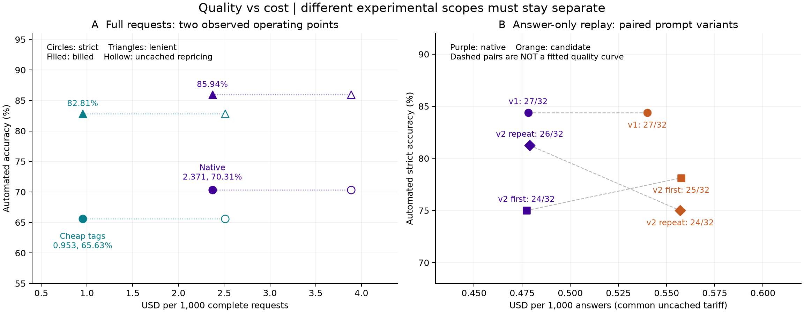
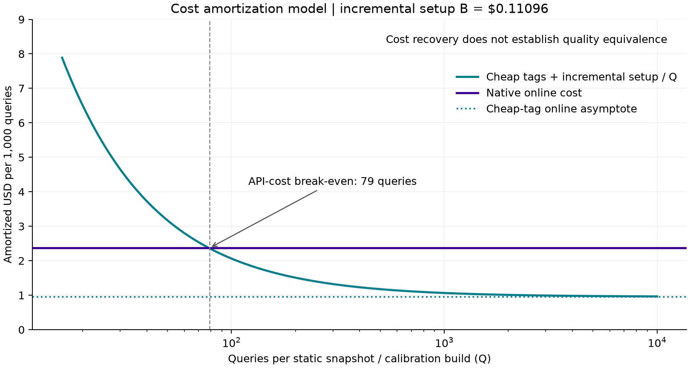

# 回退后的质量—成本分析

日期：2026-11-23。**廉价 tag 选择器显示了明显的成本优势，但尚未证明保质；新增答案规则没有形成稳定的更优工作点，因此已回退。**

本次没有新增模型调用。图表和数字来自已完成的冻结实验及开发重放，原始结果不变。可公开复算的[汇总数据](data/native_tag_quality_cost_20261123.json)只包含聚合指标和来源指纹，不包含会话原文、凭据或完整调用记录。

## 1. 完整请求：便宜很多，但存在质量折中

同一 32 题、每题两次完整运行，原生 N 与廉价选择器 S 各 64 次请求：

| 指标 | 原生 MRAgent N | 廉价 tag 选择器 S |
|---|---:|---:|
| 自动严格正确率 | 70.31%（45/64） | 65.63%（42/64） |
| 自动宽松正确率 | 85.94%（55/64） | 82.81%（53/64） |
| 在线 API 费／1,000 次完整请求 | $2.371 | $0.953 |
| 全部输入按未命中缓存价格重计／1,000 次 | $3.887 | $2.508 |
| 每个自动严格判对答案的 API 支出 | $0.003372 | $0.001452 |
| 平均完整 wall time | 17.83 秒 | 9.24 秒 |

在线费用下降 **59.82%**，严格分数下降 **4.6875 个百分点**；统一按无缓存价格重计，费用仍下降 **35.48%**。缓存命中差异放大了成本优势，但不能完全解释它。主要节省来自初始和扩展 tag 模型调用的移除；二者原生平均每请求约 $0.001366，占本次观测在线节省的约 96.3%。



左图实心点采用本轮冻结账本计价，空心点是同一请求的无缓存重计，水平虚线只表示计价变化。圆形为 strict、三角形为 lenient；宽松结果是评测敏感性，不能拿它替换主指标。右图单独展示回答阶段重放，横轴含义和样本均不同，不能与左图混合排名。

按自动严格分数和在线费用，N 和 S 是两个互不支配的工作点：N 更准，S 更便宜。这里只有两个方法点，没有固定预算的多档实验，**无法推出平滑质量—成本曲线、最优拐点或中间预算的表现**。随机混用两种方法可以算期望直线，但那不是已经验证的路由策略，所以本报告不画成实测前沿。

若仅把观测比例外推作成本解释：每 1,000 次请求，N 多花约 $1.418，平均多得到约 46.875 个自动判对答案，约为 **每增加一个正确答案 $0.0303**。这是描述性边际代价，不是实际新增 1,000 题的成绩，也不是错误风险的货币估值。每正确答案成本较低，不代表高风险任务可以接受更多错误。

质量结论仍受 42 条待人工复核运行影响；对称未决处理下 S−N 的可能范围为 **[−18.75，+18.75] 个百分点**，这不是统计置信区间。只有四个会话、32 道题，重复试次也不是独立新题。因此目前只能主张“观测到降本与质量折中”，不能主张非劣效或保质降本，原协议的 `inconclusive` 不变。

## 2. 离线成本摊薄：79 次查询只是经济回本点

本轮增量离线 API 投入 B = $0.110958468，包含校准与相关验收投入；共用的原生建图成本不重复计入。若一个快照／配置不变且沿用本轮在线均值：

\[
C_S(Q)=0.00095271965625+\frac{0.110958468}{Q},\qquad
C_N=0.002370882046875.
\]



| 每次构建后的查询数 Q | S 摊销后每请求 API 费 | 相对 N |
|---:|---:|---:|
| 32 | $0.004420 | 贵 86.44% |
| 64 | $0.002686 | 贵 13.31% |
| 79 | $0.002357 | 开始回本，省约 0.57% |
| 128 | $0.001820 | 省 23.25% |
| 1,000 | $0.001064 | 省 55.14% |

这条连续曲线来自明确的摊销公式，不是拟合出的质量曲线。**API 回本量为 79 次查询，不代表质量在第 79 次恢复。** 频繁更新快照或校准配置会重置相应成本；若每次更新后只有几十次查询，离线投入可能抵消在线省钱。曲线不含本地算力货币估价、人工复核和研究试错总成本，也不承诺未来服务商费率与缓存行为不变。

对于已经拥有当前资产、准备继续查询的情况，已支付的 B 属于沉没成本，后续增量决策应看在线费用；摊销曲线用于评估新部署或需要重建的快照，不能在每一批查询中重复收取整笔 B。

## 3. 答案修正版：成本右移，质量收益不稳定

以下都是同一 16 道开发题的 32 个已有上下文，仅重新回答和自动评分，没有重新运行检索。每轮原生／候选各回答 32 次，所有失败保留分母。

为了排除服务端缓存差异，右图统一采用历史参考费率（输入 $0.15/M、输出 $0.60/M）将全部输入按未命中计价；**它是统一价格情景，不是 2026-11-23 的实际账单**。

| 配对轮次 | 原生 strict | 修正版 strict | 原生重计费／1,000 次回答 | 修正版重计费／1,000 次回答 |
|---|---:|---:|---:|---:|
| v1 | 27/32 | 27/32 | $0.4781 | $0.5400 |
| v2 首轮 | 24/32 | 25/32 | $0.4772 | $0.5576 |
| v2 重复 | 26/32 | 24/32 | $0.4789 | $0.5570 |

v1 在这一轮中成本更高、质量相同；v2 首轮曾多判对一次，但重复运行少判对两次。统一价格下，v2 回答阶段成本比同期原生高约 **16%—17%**；输入 token 本身增加 **18.76%**，输出略少，所以两个增幅不同。

仅作描述性合并，两轮 v2 共 64 次回答中原生判对 50 次、修正版 49 次；仍然只有 16 道题，不能据此当作新的 64 题确认集。修正版重复轮还出现一次漏 `mode` 的格式失败，以及有证据却拒答的情况。较长的通用规则提示没有稳定地把工作点移向“更准且更便宜”的方向，回退有数据依据。

## 4. 回退范围、验证和后续研究

已恢复到 **2026-11-22 工具错误误报修复之后、2026-11-23 答案优化之前**的实现。包括恢复 `runtime.py`、`experiment.py`、`cli.py`，移出本轮新增的答案候选、扩展诊断／重放模块及相应测试。12 个实现文件的 SHA256 与修正前清单逐项相同；廉价 tag 选择器、原生读取／回答、已有计费与误报修复均保留。

候选源码、原始结果、诊断报告和重放记录已归档，不删除负结果。旧的优化报告描述当时版本，不能作为当前运行命令说明。当前使用[修正前的实现说明](native_tag_selector_implementation_20261122.md)。回退后全仓 **371 项测试通过**，包括配置本地 MRAgent 路径后的上游集成测试。

研究优先级应回到 **在保留成本优势的条件下，提高廉价选择器的证据覆盖**。下一轮若要得到真正的质量—成本曲线，需要预先冻结若干可比工作点，在相同新样本、模型、评测和费用口径下完整运行；目前不能用回答重放的成本冒充完整请求成本，也不能根据已看过的主样本挑阈值。

本报告对应的图表、聚合数据和生成脚本可随代码推送；原始账本与对话记录继续保留在本地忽略目录 `artifacts/`。复图命令：

```bash
python -m pip install matplotlib
python scripts/native_tag_quality_cost_analysis.py
```

默认只读取已提交的聚合数据；`--refresh` 需要本地原始实验产物。另有可导出的[质量—成本 PDF](figures/native_tag_quality_cost_20261123.pdf)和[摊销 PDF](figures/native_tag_amortization_20261123.pdf)。
